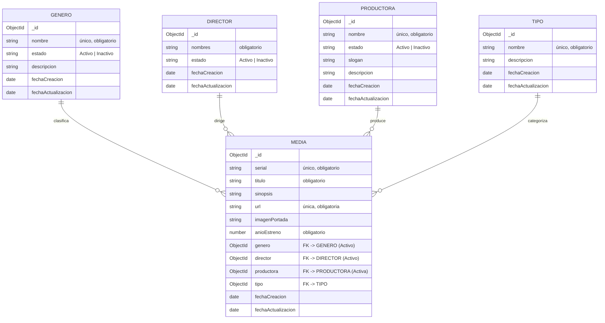

# API REST – Películas y Series (IU Digital)

API REST construida con **Node.js + Express + MongoDB (Mongoose)** para el caso de estudio *Ingeniería Web II*.
La Institución Universitaria Digital de Antioquia necesita una aplicación web (modo Administrador) para publicar películas y series.
Esta API cubre el backend de los cinco módulos definidos: **Género, Director, Productora, Tipo y Media**.

**Integrantes:**
- Alejandro Arango Calderón

---

## Tecnologías

| Herramienta | Uso |
|---|---|
| Node.js 18+ | Entorno de ejecución de JavaScript en el servidor |
| Express 4 | Framework HTTP para definir las rutas REST |
| MongoDB / MongoDB Atlas | Base de datos NoSQL |
| Mongoose 8 | Modelado de datos, validaciones y relaciones |
| dotenv, cors, morgan | Variables de entorno, CORS y logs de peticiones |
| Postman | Cliente para probar la API |

## Estructura del proyecto

```
├── postman/
│   └── API-Peliculas.postman_collection.json   # Colección lista para importar en Postman
├── scripts/
│   ├── seed.js            # Carga géneros y tipos iniciales
│   └── smoke-test.js      # Prueba automática de todos los endpoints
└── src/
    ├── index.js           # Punto de entrada: conecta a MongoDB y levanta el servidor
    ├── app.js             # Configuración de Express y registro de rutas
    ├── db/conexion.js     # Conexión a MongoDB
    ├── models/            # Esquemas: Genero, Director, Productora, Tipo, Media
    ├── controllers/       # Lógica de cada módulo (crud.js es la base compartida)
    ├── routes/            # Rutas REST de cada módulo
    ├── middlewares/       # Manejo centralizado de errores
    └── helpers/           # Utilidades
```

## Diseño de la base de datos

Se usa MongoDB con una colección por módulo. **Media** guarda referencias (`ObjectId`) a Género, Director, Productora y Tipo.
Así, una película o serie tiene **un único** género, director, productora y tipo, como pide el caso de estudio.



`fechaCreacion` y `fechaActualizacion` las maneja Mongoose de forma automática (`timestamps`): el cliente no las envía.

### Reglas de negocio implementadas

- **Estado** solo admite `Activo` o `Inactivo` (por defecto `Activo`). El módulo Tipo no maneja estado, según el caso.
- Al **crear o editar una Media** solo se aceptan géneros, directores y productoras **activos**, y tipos que existan.
- `serial` y `url` de la Media son **únicos**. También lo son los nombres de género, productora y tipo.
- No se puede **eliminar** un género, director, productora o tipo que esté asociado a alguna Media (responde `409`).
- Solo se aceptan los campos definidos en cada módulo: el cliente no puede modificar `_id` ni las fechas.

## Instalación y ejecución

1. Clonar el repositorio e instalar dependencias:
   ```bash
   npm install
   ```
2. Crear el archivo `.env` a partir de `.env.example` y poner la cadena de conexión de MongoDB (local o Atlas):
   ```
   PORT=4000
   MONGO_URI=mongodb+srv://<usuario>:<password>@<cluster>.mongodb.net/peliculas
   ```
3. (Opcional) Cargar los datos iniciales del caso (acción, aventura, ciencia ficción, drama, terror; serie y película):
   ```bash
   npm run seed
   ```
4. Iniciar la API:
   ```bash
   npm run dev
   ```
   La API queda disponible en `http://localhost:4000`.

### Pruebas automáticas

```bash
npm test
```

Levanta una base de datos MongoDB en memoria (no requiere MongoDB instalado) y prueba 20 escenarios de los cinco módulos: creación, edición, validaciones, duplicados, estados inactivos y eliminación.

## Endpoints

Todos los módulos exponen las mismas operaciones REST:

| Método | Ruta | Descripción | Respuesta OK |
|---|---|---|---|
| `GET` | `/api/{recurso}` | Listar registros (admite filtros por query) | 200 |
| `GET` | `/api/{recurso}/:id` | Obtener un registro por id | 200 |
| `POST` | `/api/{recurso}` | Crear un registro | 201 |
| `PUT` | `/api/{recurso}/:id` | Actualizar un registro (solo los campos enviados) | 200 |
| `DELETE` | `/api/{recurso}/:id` | Eliminar un registro | 200 |

| Módulo | Recurso | Campos del body | Filtros en `GET` |
|---|---|---|---|
| Género | `/api/generos` | `nombre`*, `estado`, `descripcion` | `?estado=Activo` |
| Director | `/api/directores` | `nombres`*, `estado` | `?estado=Activo` |
| Productora | `/api/productoras` | `nombre`*, `estado`, `slogan`, `descripcion` | `?estado=Activo` |
| Tipo | `/api/tipos` | `nombre`*, `descripcion` | — |
| Media | `/api/medias` | `serial`*, `titulo`*, `sinopsis`, `url`*, `imagenPortada`, `anioEstreno`*, `genero`*, `director`*, `productora`*, `tipo`* | `?titulo=`, `?genero=`, `?director=`, `?productora=`, `?tipo=`, `?anioEstreno=` |

\* obligatorio al crear.

### Ejemplos

**Crear género** – `POST /api/generos`
```json
{ "nombre": "Ciencia ficción", "estado": "Activo", "descripcion": "Historias basadas en avances científicos" }
```

**Crear media** – `POST /api/medias`
```json
{
  "serial": "IUD-0001",
  "titulo": "Interstellar",
  "sinopsis": "Un grupo de exploradores viaja a través de un agujero de gusano...",
  "url": "https://peliculas.iudigital.edu.co/interstellar",
  "imagenPortada": "https://image.tmdb.org/t/p/w500/interstellar.jpg",
  "anioEstreno": 2014,
  "genero": "<id del género>",
  "director": "<id del director>",
  "productora": "<id de la productora>",
  "tipo": "<id del tipo>"
}
```
La respuesta trae los datos de género, director, productora y tipo en lugar de solo sus ids.

### Códigos de error

| Código | Cuándo ocurre |
|---|---|
| `400` | Datos inválidos, falta un campo obligatorio, id mal formado, o se asigna un género/director/productora inactivo |
| `404` | No existe el registro o la ruta |
| `409` | Valor único repetido (serial, url, nombre) o se intenta eliminar un registro en uso |
| `500` | Error interno del servidor |

Ejemplo de error:
```json
{ "mensaje": "Datos inválidos", "errores": ["El serial es obligatorio", "El título es obligatorio"] }
```

## Pruebas con Postman

1. En Postman: **Import** → seleccionar `postman/API-Peliculas.postman_collection.json`.
2. Verificar que la variable de la colección `baseUrl` sea `http://localhost:4000`.
3. Ejecutar las carpetas en orden (**1. Género → 6. Eliminar**), una por una o con *Run collection*.
   Cada petición *Crear* guarda el `_id` en una variable (`generoId`, `directorId`, etc.), así las peticiones de Media y las de actualizar/eliminar funcionan sin copiar ids a mano.
